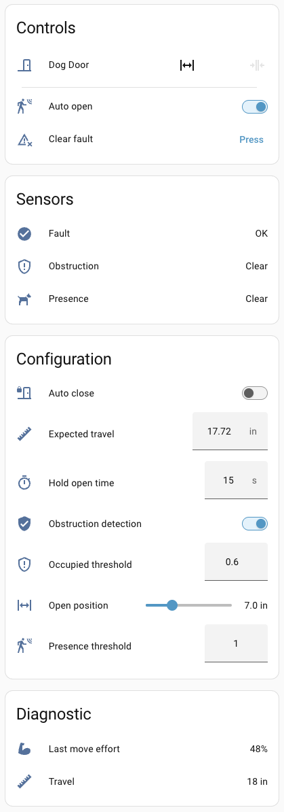
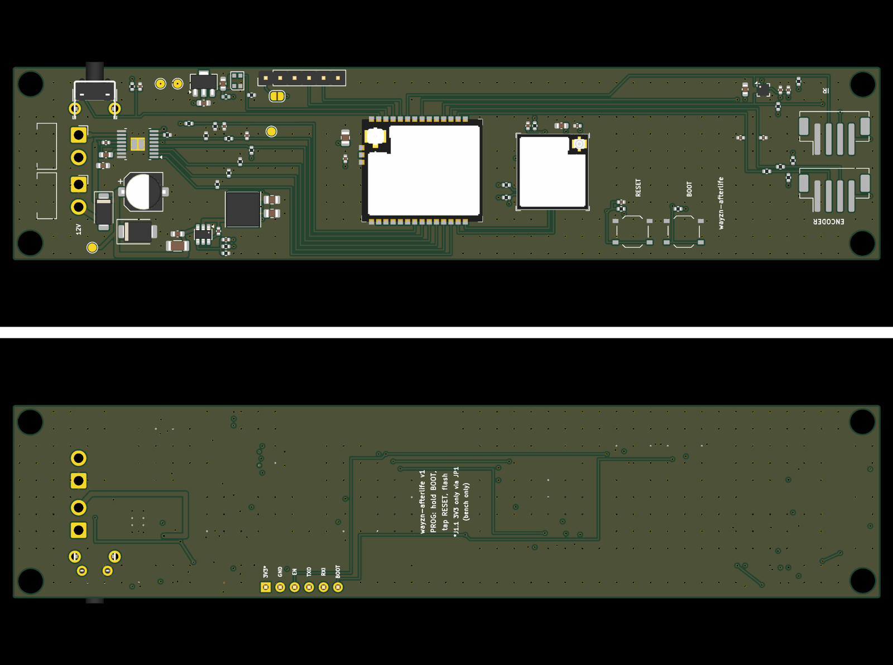
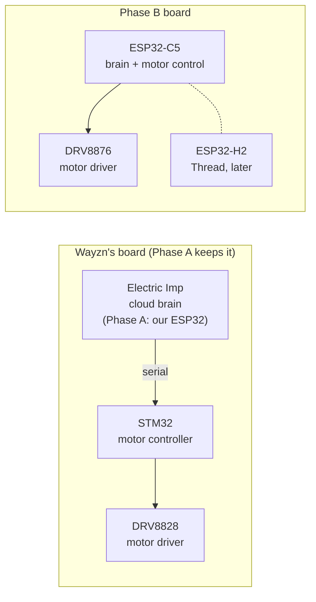
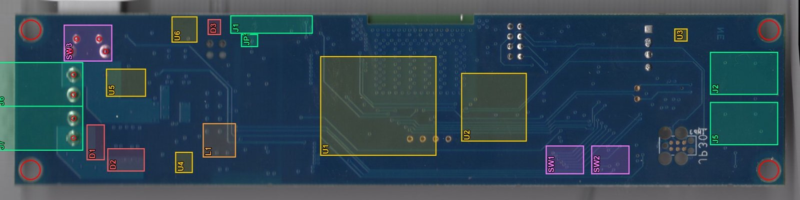

# wayzn-afterlife

**Your Wayzn dog door doesn't have to die with the cloud, and it can come back better.**

Wayzn is shutting its service down in March 2027. The door on your slider is still a
good machine: a strong motor, a careful motor controller and a thermal sensor that sees
your dog. Only its "brain" was tied to the cloud. Swap that brain for a small ESP32
board and the door keeps working, entirely on your own network.

![Three stages. Original: the Wayzn app, Wayzn's cloud and the Electric Imp cloud drive the imp module, which drives Wayzn's STM32 motor controller and DRV8828 motor driver. Phase A, working today: your home automation talks over local Wi-Fi to an ESP32 brain that replaces the imp; Wayzn's STM32 and driver stay. Phase B, in design: one ESP32-C5 on our own board does the brain and the motor control, with a DRV8876 driver; the STM32 is gone. The door's motor, encoder, thermal sensor and case are kept throughout.](docs/before-after.svg)

## Two phases

| | What it is | Status |
|---|---|---|
| **[Phase A](#phase-a-an-esp32-brain-on-your-existing-board)** | Add an ESP32 dev board to the door's existing control board. It takes over from the cloud brain and controls the original hardware. | **Works today.** Running in a real door every day. |
| **[Phase B](#phase-b-a-replacement-control-board-in-design)** | A new control board that replaces Wayzn's entirely: same size, same connectors, an ESP32 that drives the motor itself. | **In design and validation.** Not ready to build yet. |

If you have a Wayzn door and want it working after the shutdown, **Phase A is the one to
do.**

## Phase A: an ESP32 brain on your existing board

### What you get

- **A door that keeps working.** No account, no cloud, no company that can switch it
  off.
- **Local control.** A small HTTP API on your network: open, close, live status (open,
  closed, opening, closing) and the door's settings, such as auto-open, how far it
  opens, how long it holds and how sensitive it is. A Home Assistant integration that
  uses it is available (pictured below).
- **Smarter dog detection.** The brain sees every raw reading from the door's thermal
  sensor, so it can do much better than a grid of cells and a small/medium/large
  setting. Fewer false opens, and a door that doesn't close on a dog standing beside it.
- **Safety first.** The original motor-control and current-limit (strength) firmware
  keeps running, untouched, so the door only ever pushes as hard as Wayzn designed it
  to. The door never closes on something it can see, and anything unexpected leaves it
  **open**: a dog is never locked out.
- **All open.** Firmware, wiring, measurements and the door's protocol are documented
  here, so you can fix and improve your own door.

### How it sees your dog

A tiny 8×8 thermal camera watches the doorway ten times a second. The brain keeps two
judgements apart: **presence** (a dog wants out, so open) and **occupied** (something is
in the doorway, so never close, and reverse if closing). Occupied is deliberately the
more sensitive one: a false alarm only keeps the door open a little longer. A new
detector that learns each pixel's own noise is already running alongside the current one
and catches dogs at the edge of the view that the original approach misses
([the numbers](docs/DETECTION-RESEARCH.md)).

### What it takes

If you're comfortable soldering a few wires to small pads, this is an evening's project.

1. **Open the door's case.** The shell is friction fit: no tools needed.
2. **Add an ESP32 and eight connections.** Seven wires and one jumper, all to test
   points and pads that Wayzn conveniently left on the board:

   

3. **Flash the firmware.** It's in [firmware/brain](firmware/brain/) (PlatformIO);
   updates after that go over Wi-Fi. The door then answers on its
   [local API](docs/API.md). For Home Assistant, the `wayzn` integration's local mode
   ([aijayadams/wayzn](https://github.com/aijayadams/wayzn)) talks to it.

## Phase B: a replacement control board (in design)

Phase A keeps Wayzn's original board and its motor controller. Phase B replaces that
board outright with an open design, so a door can be repaired or rebuilt without any
Wayzn parts, and so the motor control is open too.

#### The architecture

Wayzn's board splits the work between two chips: a cloud-connected Electric Imp module
makes the decisions, and an STM32 microcontroller runs the motor. Phase A swaps out
only the decision-maker. Phase B collapses everything into one ESP32 that both decides
and drives:

- **One chip decides and drives.** The ESP32-C5 runs the door logic, the Wi-Fi API and
  the motor control loop. There is no second microcontroller and no serial link to keep
  in sync, and every part of the motor control is open code.
- **Hardware does the time-critical work.** The C5's built-in peripherals count every
  encoder pulse, generate the motor PWM, sample the motor current and react to a driver
  fault, all without the CPU. So Wi-Fi traffic can't make the motor miss a beat. The
  software only runs a slow outer loop: Wayzn's own controller ran at 10 ms.
- **Safety sits in silicon, not in code.** The motor driver caps the force on its own,
  at 1.1 A, matching Wayzn's limit. The motor's enable lines are held off by
  resistors, so a reset, crash or firmware update leaves the motor stopped. On top of
  that the firmware adds obstruction detection: it learns what a normal move draws and
  reverses toward open on anything more.
- **A drop-in fit.** The same outline, post holes and connector positions as Wayzn's
  board, measured from scans, so the door's cables, the case and the button cap fit
  unchanged. Below, the new board's parts are drawn over a scan of Wayzn's board: the
  red circles are the case's posts and the connector and button pins, all landing on
  Wayzn's own holes.

  
- **Room to grow.** An ESP32-H2 sits beside the C5 for Thread/Matter later, and an RGB
  LED under the door's light pipe gives the status more than one colour.

**Status:** the board is designed and has had an independent design review, and the
first prototypes are being ordered. It **hasn't been built or tested yet**, and the
firmware that drives the motor directly hasn't been written. Unless you want to help
validate it, use Phase A for now. Design notes: [docs/CONTROL-BOARD.md](docs/CONTROL-BOARD.md);
the KiCad project: [hardware/control-board](hardware/control-board/).

## Go deeper

| | |
|---|---|
| [How it works](docs/HOW-IT-WORKS.md) | Phase A: the board, its buses, what the motor controller does on its own, and how the brain is built |
| [Wiring](docs/HOW-IT-WORKS.md#wiring-the-esp32) | Phase A: the connection table behind the diagram above |
| [API](docs/API.md) | The brain's local HTTP API and every setting |
| [Detection research](docs/DETECTION-RESEARCH.md) | Thermal sensor measurements and the detector comparison |
| [STM32 firmware](docs/STM-FIRMWARE.md) · [protocol](docs/STM-PROTOCOL.md) | Wayzn's motor controller: commands, states, status lines, and the motor driver's scales |
| [Hardware](docs/hardware/) | The Wayzn main board, its measured geometry, the STM32 pin map and the sensor board |
| [Control board](docs/CONTROL-BOARD.md) | Phase B: the replacement board's design, safety and control approach |
| [AGENTS.md](AGENTS.md) | The principles every change follows |

Wayzn's own STM32 firmware isn't published here; [tools/swd-dump](tools/swd-dump/) reads
your board's copy if you want one.

## What's where

| Path | Phase | What |
|---|---|---|
| `firmware/brain/` | A | The ESP32 brain firmware (PlatformIO) |
| `tools/` | A | The probing tools used to understand the board (UART/I2C sniffers, SWD dump, power test, Ghidra scripts) |
| `docs/` | A, B | How it works, the API, the door's protocol, measurements, and the Phase B design notes |
| `hardware/control-board/` | B | The replacement control board: KiCad project generated from Python, fab and order files |
| `hardware/carrier/` | A (parked) | A plug-in carrier PCB for the Phase A brain. Not needed (the dev-board wiring works); kept for reference |
| `photos/` | | Board photos and scans (serial labels blurred, no location data) |

## Join in

Own a Wayzn door? [Open an issue](https://github.com/aijayadams/wayzn-afterlife/issues)
with questions, your board's revision, photos, or ideas. Every door that keeps running
is a win.
