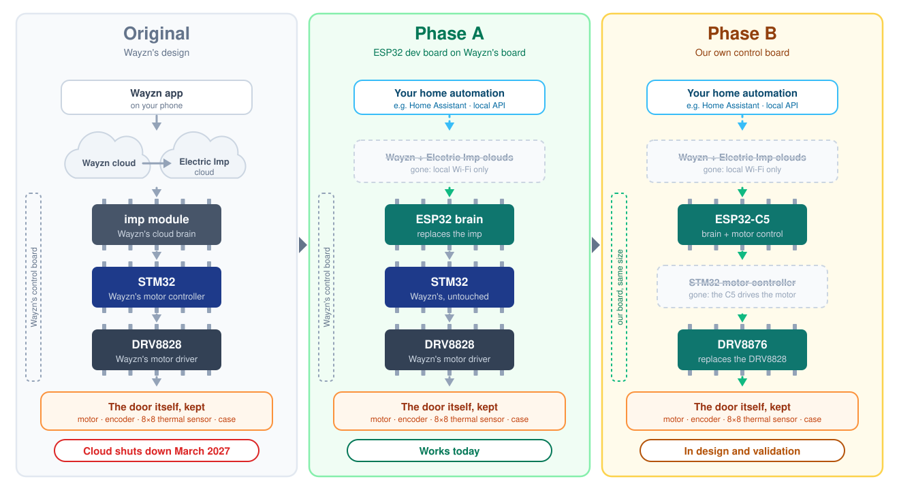
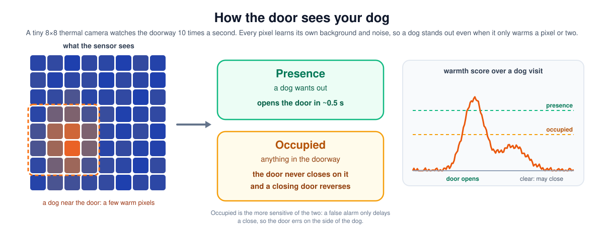
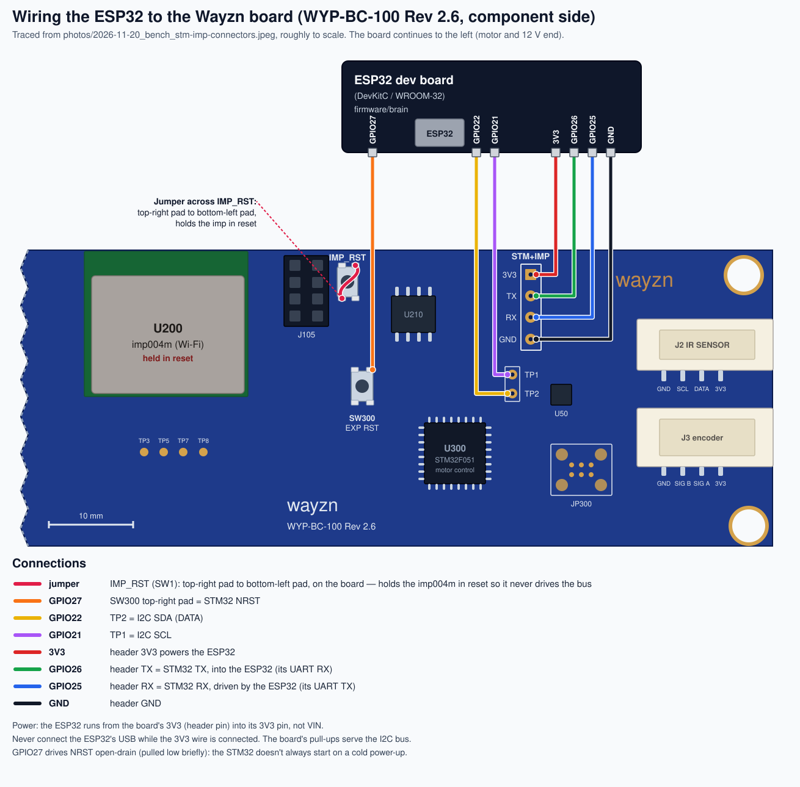

# wayzn-afterlife

**Your Wayzn dog door doesn't have to die with the cloud, and it can come back better.**

Wayzn is shutting its service down in March 2027. The door on your slider is still a
good machine: a strong motor, a careful motor controller and a thermal sensor that sees
your dog. Only its "brain" was tied to the cloud. Swap that brain for a small ESP32
board and the door keeps working, entirely inside your home, with Home Assistant.

## What you get

- **A door that keeps working.** No account, no cloud, no company that can switch it
  off. It even works when the internet is down.
- **Home Assistant control.** Open, close and live status (open, closed, opening,
  closing), plus the door's settings: auto-open on a schedule, how far it opens, how
  long it holds, and how sensitive it is.
- **Smarter dog detection.** The brain sees every raw reading from the door's thermal
  sensor, so it can do much better than a grid of cells and a small/medium/large
  setting. Fewer false opens, and a door that doesn't close on a dog standing beside it.
- **Safety first.** Wayzn's own motor and safety firmware keeps running, untouched. The
  door never closes on something it can see, and anything unexpected leaves it **open**:
  a dog is never locked out.
- **All open.** Firmware, wiring, measurements and the door's protocol are documented
  here, so you can fix and improve your own door.

## How it sees your dog

A tiny 8×8 thermal camera watches the doorway ten times a second. The brain keeps two
judgements apart: **presence** (a dog wants out, so open) and **occupied** (something is
in the doorway, so never close, and reverse if closing). Occupied is deliberately the
more sensitive one: a false alarm only keeps the door open a little longer. A new
detector that learns each pixel's own noise is already running alongside the current one
and catches dogs at the edge of the view that the original approach misses
([the numbers](docs/DETECTION-RESEARCH.md)).

## What it takes

If you're comfortable soldering a few wires to small pads, this is an evening's project.

1. **Open the door's case.** The shell is friction fit: no tools needed.
2. **Add an ESP32 and eight connections.** Seven wires and one jumper, all to test
   points and pads that Wayzn conveniently left on the board:

   

3. **Flash the firmware and add the door to Home Assistant.** The firmware is in
   [firmware/brain](firmware/brain/) (PlatformIO). Updates after that go over Wi-Fi. The
   Home Assistant side is the `wayzn` integration's local mode,
   [aijayadams/wayzn](https://github.com/aijayadams/wayzn).

Never connect the ESP32's USB while its 3V3 wire is connected, and strain-relieve the
wires: they're small and run next to the motor.

## Go deeper

| | |
|---|---|
| [How it works](docs/HOW-IT-WORKS.md) | The board, its buses, what the motor controller does on its own, and how the brain is built |
| [Wiring](docs/HOW-IT-WORKS.md#wiring-the-esp32) | The connection table behind the diagram above |
| [API](docs/API.md) | The brain's local HTTP API and every setting |
| [Detection research](docs/DETECTION-RESEARCH.md) | Thermal sensor measurements and the detector comparison |
| [STM32 firmware](docs/STM-FIRMWARE.md) · [protocol](docs/STM-PROTOCOL.md) | Wayzn's motor controller: commands, states and status lines |
| [Hardware](docs/hardware/) | The main board, the STM32 pin map and the sensor board |
| [AGENTS.md](AGENTS.md) | The principles every change follows |

Wayzn's own STM32 firmware isn't published here; [tools/swd-dump](tools/swd-dump/) reads
your board's copy if you want one.

## Join in

Own a Wayzn door? [Open an issue](https://github.com/aijayadams/wayzn-afterlife/issues)
with questions, your board's revision, photos, or ideas. Every door that keeps running
is a win.
