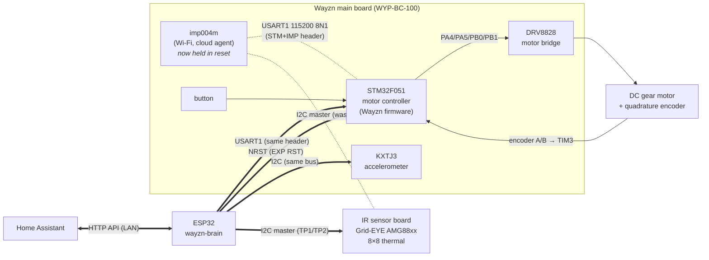
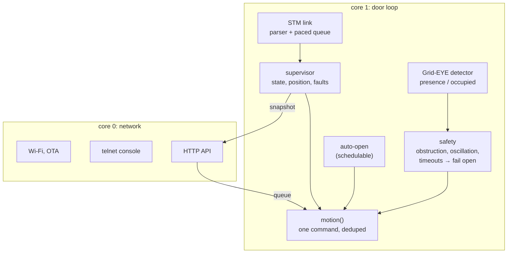

# wayzn-afterlife

Keeping a Wayzn sliding-door dog door running after Wayzn shut down.

Wayzn's door was controlled through Wayzn's cloud (Firebase) and an Electric Imp
module on the door's board. With the company gone, the cloud and the imp's agent
stopped working. This repo documents the board, reverse engineered, and holds a
replacement brain: **an ESP32 that takes the imp's place**. It drives the board's STM32 motor controller over the imp's own UART, reads the
door's sensors, and gives Home Assistant a small local API. The STM32 keeps
running Wayzn's own motor firmware, untouched.

Governing principles (from [AGENTS.md](AGENTS.md)): never lie about the door's
state (unknown is a valid answer); open beats oscillating; oscillating is a fault;
**never lock a dog out** (every failure ends with the door open).

## How the door works

The main board (WYP-BC-100) has two processors: an **imp004m** (Wi-Fi, the
"brain", talking to Wayzn's cloud) and an **STM32F051** (the motor controller).
The imp decided *when* to move; the STM32 decides *how*, and protects the motor and
whatever is in the way.

## Buses

| Bus | Pins | Who / what | Notes |
|---|---|---|---|
| **USART1** | STM32 PA9 (TX) / PA10 (RX) → the unpopulated "STM+IMP" header | imp ↔ STM32 | 115200 8N1, 3.3 V. The STM32 runs a text shell on it (45 commands: `open`, `close`, `set_profile`, `zero`, `get_profile`, …) and prints a hex status line every 1.5 s (10 s when idle). **This is how the ESP32 drives the door.** [docs/STM-PROTOCOL.md](docs/STM-PROTOCOL.md), [docs/STM-FIRMWARE.md](docs/STM-FIRMWARE.md) |
| **USART2** | STM32 PA2 / PA3 → JP300 pads 3 / 5 | STM32 debug console | Same shell; some commands (`getstate`, reboot reason) only print here. |
| **I2C** | J2 "IR SENSOR" SCL/DATA = test points TP1/TP2, 4.7 kΩ pull-ups | imp (Wayzn firmware) or **the ESP32 brain** (master) | ~100 kHz. **Grid-EYE at 0x69** (thermal presence, read 128 B every 100 ms) and **Kionix KXTJ3 accelerometer at 0x0F** (U50 on the main board; the imp used it to tell the drive's engaged/disengaged lever; the brain doesn't use it). No STM32 pin on this bus. |
| **SWD** | JP300 pads 1 (SWDIO), 6 (SWCLK), 2 (VDD) | STM32 | RDP level 0: the flash reads out over SWD (read-only dump: tools/swd-dump). |
| **Encoder** | J5 SIG A/B → PA7/PA6 (TIM3 encoder mode) | motor → STM32 | ~13 500 counts full travel (13 588 on the door in `door-config/`); the imp's "8 inch" open position is −6136. |
| **Motor drive** | PA4, PA5, PB0, PB1 → DRV8828 | STM32 → motor | Current sensed via a shunt → amp → PA1; supply sense on PA0. |
| **Resets** | SW300 "EXP RST" = STM32 NRST; SW1 = imp reset | | BOOT0 is tied low, so the STM32 always boots its flash. The imp is held in reset permanently; the ESP32 drives NRST (open-drain). |

Board details: [WYP-BC-100](docs/hardware/WYP-BC-100.md),
[STM32 pin map](docs/hardware/STM32-PINMAP.md),
[IR sensor board](docs/hardware/ir-sensor-board.md).

## What the STM32 does on its own

From the decompiled firmware ([docs/STM-FIRMWARE.md](docs/STM-FIRMWARE.md)), verified on
the door:

- **Moves** to targets with a PID loop, using a learned **current profile** (2 × 144
  buckets of expected motor current along the travel) to set its current limit.
- **Protects**: over-current (>35 ticks over the profiled limit) and stall detection;
  an obstruction flag (`set_obstruction`) set during a close makes it reverse.
- **Knows nothing it isn't told**: position is relative to `zero <pos> <state>` and is
  lost on every reboot; the profile and settings are RAM-only too. The imp re-sent
  them after every STM boot, and so does the ESP32 brain.
- **Has no host timeout**: a move in progress finishes even if the host dies.
- Quirks: it doesn't always start on a cold power-up without a reset pulse (the imp
  gave one); a full-current calibration push against the closed door can brown it out
  (it reboots; the brain treats that as "reached closed").

## The replacement brain (ESP32)

Production firmware in [firmware/brain/](firmware/brain/) (PlatformIO, Arduino-ESP32):

- **STM supervisor**: parses the status stream, adopts the STM's state after an ESP32
  update (no reset), re-sends the setup after every STM reboot, resets a silent STM
  through NRST, marks position *unknown* unless it can prove it.
- **Grid-EYE presence**: a learned per-pixel background; the score is the summed
  rise over a noise floor (a dog warms 4–7 pixels by only 1–2 °C). Two levels:
  *presence* (open for the dog) and a more sensitive *occupied* (never close, and
  reverse a close).
- **Shadow detector**: a second Grid-EYE detector (`presence2.h`: per-pixel smoothing
  and noise normalisation, more sensitive to a dog at the edge of the view) runs on
  every frame and only logs, including where it would have blocked or reversed a close.
  See [docs/DETECTION-RESEARCH.md](docs/DETECTION-RESEARCH.md).
- **Safety**: closes only when the position is known, the sensor is reading and the
  doorway is clear; `set_obstruction` only while closing; 3 reversals in 2 min, a move
  timeout or a failed calibration latch the door **open** with a fault. An open with
  unknown position drives fully open.
- **Home Assistant**: `GET /api/status`, `POST /api/open|close|stop|auto|settings`
  with a bearer token ([docs/API.md](docs/API.md)). An open from HA holds the door
  until HA closes it. `/api/settings` sets auto-open, auto-close, obstruction
  detection, hold time, open position and detector thresholds; all values are
  validated, applied all-or-nothing, saved on the door and logged. The HA side is the `wayzn` integration's local mode
  ([aijayadams/wayzn](https://github.com/aijayadams/wayzn)).

- **Logs**: a telnet console (`nc wayzn-esp.local 23`), and optionally every event
  line as RFC 5424 syslog over UDP ([firmware/brain/README.md](firmware/brain/README.md)).

Secrets (Wi-Fi, OTA, API token, syslog host) live only in a gitignored `secrets.ini`
(template: [tools/uart-sniffer/secrets.ini.example](tools/uart-sniffer/secrets.ini.example)).

## Wiring the ESP32

| ESP32 | Board | Why |
|---|---|---|
| 3V3 | STM+IMP header **3V3** (square pad) | power from the board (into 3V3, not VIN) |
| GND | STM+IMP header **GND** | |
| GPIO26 | STM+IMP header **TX** (STM32 TX) | ESP32 receives the STM32's status and replies |
| GPIO25 | STM+IMP header **RX** (STM32 RX) | ESP32 sends shell commands |
| GPIO21 | **TP1** (I2C SCL) | Grid-EYE and accelerometer bus |
| GPIO22 | **TP2** (I2C SDA) | |
| GPIO27 | **SW300 (EXP RST), top-right pad** (STM32 NRST) | open-drain reset pulse at boot and if the STM32 goes silent |
| (jumper) | **IMP_RST (SW1): top-right pad to bottom-left pad** | holds the imp004m in reset so it never drives the UART or I2C |

Roughly to scale, traced from [photos/2026-11-20_bench_stm-imp-connectors.jpeg](photos/2026-11-20_bench_stm-imp-connectors.jpeg)
(`tools/wiring/gen_wiring.py` regenerates it). **Never connect the ESP32's USB while its 3V3
wire is connected.** The tap points are small and the wires run next to the motor:
strain-relieve them (glue or tape near the joints) and keep them short.

## Layout

| Path | What |
|---|---|
| [AGENTS.md](AGENTS.md) | Governing principles; read first |
| [docs/STM-FIRMWARE.md](docs/STM-FIRMWARE.md) | What the STM32 firmware does (commands, states, safety) |
| [docs/STM-PROTOCOL.md](docs/STM-PROTOCOL.md) | The imp ↔ STM32 UART protocol on the wire |
| [docs/API.md](docs/API.md) | The brain's HTTP API, including settings |
| [docs/DETECTION-RESEARCH.md](docs/DETECTION-RESEARCH.md) | Grid-EYE detection: sensor measurements, detector comparison |
| [docs/hardware/](docs/hardware/) | Board, pin map, IR sensor board |
| [firmware/brain/](firmware/brain/) | Production ESP32 firmware (+ host tests and detector research tools) |
| [door-config/](door-config/) | An example door's learned profile and STM setup lines |
| [tools/](tools/) | Bench tools: uart-sniffer, i2c-sniffer, swd-dump (read-only), power-test, Ghidra scripts, wiring diagram generator |
| [photos/](photos/) | Board photos |

Wayzn's STM32 firmware (flash dumps, decompiles) is not in this repo: dump your own board
with `tools/swd-dump`.

## Status

The ESP32 brain runs the door with the imp held in reset: Grid-EYE auto-open and
auto-close (switchable from Home Assistant, e.g. on a schedule), HA open/close through
the local API, and the v2 detector in shadow mode.
