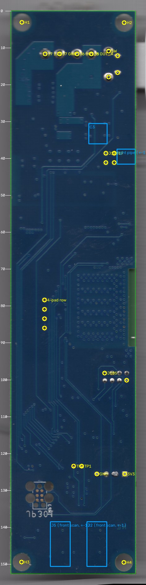

# WYP-BC-100: board geometry (from 1200 dpi scans, 2026-11-24)

Both sides of a bench board were scanned at 1200 dpi with a ruler on the glass; the ruler agrees with the
nominal 1200 dpi to ~0.3 %. The back scan is here, straightened, at 600 dpi:
`photos/2026-11-24_bench_scan-back-600dpi.jpeg`. The front scan isn't published (it shows the unit's serial label).

- **Back scan** (solder side down, flat on the glass): sharp. The outline, holes and every through-hole pad are
  measured from it by image analysis (board straightened by its outline, pads found as unmasked blobs, centroids).
  Tag: **verified** (scan), ±0.1 mm.
- **Front scan**: blurry (the tall parts hold the board off the glass). Used only for SMD-only features, registered
  to the back scan by the J6/J7 pins. Tag: **inferred (front scan)**, ±1 mm.

## Frame

Seen from the **component side**, **J6/J7 end at the top**. Origin = the board corner at the J6/J7 end on the
side away from the button. x across the board (0 → 33.94, toward the button side), y along it (0 → 152.6, toward
J2/J5). mm.

## Measurements

| Feature | Position (x, y) | Notes | Tag |
|---|---|---|---|
| Outline | 33.94 × 152.6 | Rectangle; the owner's 34 mm width checks | verified |
| Mounting holes | (2.99, 3.08), (30.94, 3.16), (2.94, 149.42), (30.86, 149.49) | 27.95 apart across, 146.3 along, ~3 mm from each edge. Unmasked ring Ø ~4.9; hole Ø ~4 (owner, calipers). The shell posts go through them | verified |
| J7 power (VH 2-pin, side entry) | 12V (9.36, 11.6), GND (13.29, 11.6) | Pitch 3.93: JST VH 3.96. Plug enters from the board end (y < 0) | verified |
| J6 motor (VH 2-pin, side entry) | OUT_B (18.03, 11.6), OUT_A (21.99, 11.6) | Pitch 3.96. OUT_B is next to J7's GND | verified |
| Button (right-angle tactile switch) | Large pads (26.66, 10.92), (26.65, 17.89); small (29.12, 12.19), (29.12, 16.70) | Orange plunger ends ~1.5 mm past the long edge (x ≈ 35.4), axis ~3 mm above the board top; the white cap (removable) press-fits onto it at y ~9–20 (photos, ±1 mm) | verified (pads); inferred (heights) |
| C3 (100 µF can, 8 mm) | centre ~(23.8, 33.2) | The tallest part near the J6/J7 end | inferred (front scan) |
| Status LED light pipe | ~x 29–34 (at the edge), y 37.5–41.5 | A standard right-angle pipe beside C3, sticking out ~4 mm past the long edge, sitting low over the board (photos, ±1 mm). A catalogue part with the same exit height replaces it. D1004 under it; 4 through-hole pads at (25.89/28.18, 38.58/41.12), probably the pipe's holder J1001 | pads verified; pipe inferred |
| TP3/TP5/TP7/TP8 "E L R S" | x 9.18; y 78.32, 80.86, 83.42, 85.95 | 2.54 pitch (silkscreen labels) | verified |
| J105 (2x4, 2.0 mm) | x 25.63, 27.64, 29.62, 31.64; y 98.18, 100.16 | | verified |
| TP1 / TP2 (I2C SCL / SDA) | (19.32, 123.4) / (17.16, 123.4) | | verified |
| STM+IMP header (1x4, 2.54) | y 125.55; 3V3 (square) x 31.11, TX 28.49, RX 26.03, GND 23.46 | | verified |
| JP301 (Tag-Connect, back side) | ~(7.8, 131.1) | | verified |
| J5 encoder (PH 4-pin, SMD, **top entry**) | housing x 10.8–16.2, y 138.5–150.6 | Pins run along the board, pin 1 (GND) toward the board's middle (photos). Plug enters from above (owner) | inferred (front scan) |
| J2 IR sensor (PH 4-pin, SMD) | housing x 20.8–26.2, y 138.5–150.6 | As J5 | inferred (front scan) |

## In the carrier frame

The carrier (`hardware/carrier/design.py`, Phase A, parked) uses origin = STM+IMP 3V3 pin, +x toward J2/J5, +y toward the header's
GND pin: **X = y − 125.55, Y = 31.11 − x**. Its `WAYZN` values were photo-measured; the scan corrects them:

| | Photo estimate | Scan |
|---|---|---|
| Board long edges (Y) | −2.93, 31.07 | −2.83, 31.11 |
| J2/J5 end of the board (X) | 28.4 | **27.05** |
| Posts at the J2/J5 end (X, Y) | (25.8, 0.1), (25.8, 28.1) | **(23.9, 0.25), (23.9, 28.17)** |
| J105 pins X / Y | −27.5, −25.5 / −0.8 … 5.2 | −27.37, −25.39 / −0.53 … 5.48 |
| J2 / J5 (X range) | 12.4–28.4 | 13.0–25.1 (±1) |

**The posts are 1.9 mm closer to the header than the photos suggested.** A post (Ø4) occupies X 21.9–25.9, and
carrier v3's outline runs to X 23.8, so **v3 as drawn collides with both posts** (and with the lid rib that runs
through them). v3 needs its right end pulled in to ~X 21.4 before it could be ordered.
