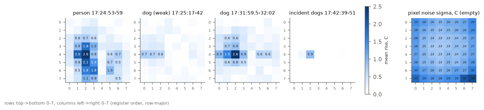
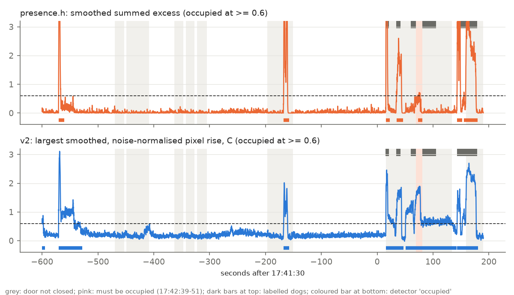

# Grid-EYE doorway detection: the original study (2026-11-21)

> The full study behind [DETECTION-RESEARCH.md](../DETECTION-RESEARCH.md), kept as written. Paths are from
> the repo root.

**Status: research only.** None of this is in the firmware. Prototype:
`firmware/brain/src/presence2.h`. Evaluation code: `firmware/brain/research/`.
Data: `captures/2026-11-21_P1_brain-door.log`. It has 53,575 raw frames (89 min, 16:43:32-18:17:25,
in 5 runs split by reboots), no dropped frames according to the device ms counter, and 13 door
moves. Labels come from the operator's narration (±2 s) and are listed in
`research/labels.py`. Tags: **verified** = measured in this data; **inferred** = interpretation.

## TL;DR

- **The 17:42 miss was a design flaw, not a tuning problem (verified).** `presence.h`
  checks each *raw* frame against a 0.7 C floor (2.7 σ) and only then sums and smooths. The
  incident dogs warmed a single pixel (r4c2) by 1.1-1.6 C, so that pixel added only about 0.5
  per frame, and the "occupied" level (0.6) was reached late and only in patches.
  Smoothing **each pixel first** (EMA, a = 0.2) brings the noise down from 0.26 C to 0.09 C.
  Over 22 min of empty doorway no smoothed pixel rose above 0.45 C.
- **Proposal ("v2")**: smooth each pixel and normalise it by its own noise, then use two
  levels. *Occupied* fires on any pixel ≥ 0.6 C or a spread-out score ≥ 0.4. *Present* fires on
  a summed score ≥ 1.0 held for 0.2 s. Two more pieces handle the door: a cooling clamp while
  it is open, and recovery after it closes. Each pixel stops learning only while it is warm.
  It needs about 2 KB of RAM and about 2k flops per frame.
- **Results on the labels:** no misses, and presence latency is unchanged or slightly better
  (median +0.4 s from the labelled start, against +0.6 s). Incident occupied coverage rises from
  0.66 to **1.00** for 17:42:39-51 and from 0.18 to **1.00** for the wider 17:42:30-43:15.
  False positives in 25 min of empty doorway: 0 (baseline 0). In 24 h of synthetic noise: 0
  (baseline 0).
- **Margin:** I added real dog signals, scaled down, into empty frames. v2 still marks the
  incident dogs *occupied* at **0.5×** amplitude (15/15). The baseline catches none of them at
  0.5× and 5/15 at 0.75×.
- **Cost:** *occupied* is held longer. After a visit it stays on for 25-95 s (baseline 1-6 s),
  and it fires in 14 unlabelled stretches, 443 s in total. Most of these are a step-like
  +0.5-0.9 C at the left edge (r4c0) that appears seconds to minutes *before* a dog visit. My
  reading is a dog waiting just beside the door (**inferred**; not labelled). That holds the
  door open longer, which is the safe direction. Per-cell weights let the user trade it away.

## 1. What the sensor sees (verified unless tagged)

| Quantity | Value |
|---|---|
| Scene (empty, door closed) | 16.4-17.9 C. Rows 6-7 are ~0.6 C warmer |
| Pixel noise (white; frame-difference σ/√2) | 0.23 C in the centre, 0.29-0.38 C at the edges and corners (r7c7 is worst). Mean 0.26 C ≈ 1 LSB |
| Common-mode noise (frame mean) | 0.08 C |
| Drift | ~0.3 C over 30 min, uniform across the scene |
| After per-pixel EMA a = 0.2 | σ 0.087 C. Empty-doorway max 0.45 C (all 64 px, 22 min) |
| Person at the door | 2.0-2.9 C over ~10 px (rows 2-7, cols 0-3). Summed excess 9-17 |
| Dog, close | 2.5-3.1 C peak (r4c2) over 3-6 px. Summed excess 4-7 |
| Dog, weak/edge (17:25) | 1.2-1.9 C on 1-2 px (r4c0/r4c1) |
| Incident dogs (17:42:39-51, door closing) | 1.1-1.6 C on **one** px (r4c2), sometimes r4c3 +0.6 |
| Door opening | Cools the doorway column by up to **1.0 C**: col 3 rows 3-6 −0.9 to −1.0 C, rest −0.2 to −0.3 C (18:03 open, 45 s). It never warms anything |
| After a long open | The scene warms back over 1-2 min (col 3 +0.5 C, rest +0.2 C; 17:46 close after 110 s open) |
| Door motion alone (6 cycles 17:33-17:36) | No warming at all. Summed excess stays ≤ 0.7 above the 0.7 C floor |

Where things appear: everything lands in **rows 3-6, cols 0-3**. Of the 18 v2 presence
onsets, 13 start at col 0-1 and the warm centroid moves to col 2-3 within 1-2 s, so arrivals
come from the left. 4 don't move (something already at the edge or in the doorway), and 1
(17:20:00) moves left, which is probably leaving. Rows 0-1 and cols 5-7
never carried a real signal. The incident map above is measured against the closed-door
background; there the dog's +1.2 C partly cancels the open-door cooling.

## 2. Current detector (`presence.h`) on the labels

The Python port `detectors.Baseline` and the C++ header agree on 100% of frames.

| Event | Presence latency (s from label start) | Occupied coverage |
|---|---|---|
| approach 16:43 | +0.9 | 0.94 |
| person 17:24 | +0.4 | 0.99 |
| weak dog 17:25 | +1.3 | 1.00 |
| dog 17:31 | +0.4 (0.4 s after the first heat, as LOG says) | 1.00 |
| dog 17:41 | +0.7 | 0.92 |
| dogs while opening 17:42:04 | +1.6 | 0.93 |
| **incident 17:42:39-51** | **miss** | **0.66** (first at +4.1 s); 0.18 over 17:42:30-43:15 |
| dog 17:43:53 | +0.3 | 0.92 |
| dog 18:03 / weak 18:03:20 | +0.6 / +1.6 | 0.95 / 0.97 |

False positives: 0 presence and 0 occupied episodes in 25 min of labelled-empty doorway, and 0 in
the 5 min of door cycling. The confidence interval is wide: 0 events in 0.5 h only bounds the
rate below about 6/h at 95%.

## 3. Alternatives compared

Full table: `python evaluate.py`. All variants detect all 7 "present" events and all 11
events for "occupied".

| Detector | Median presence latency | Incident occ (39-51 s / 30 s-43:15) | Empty FP P/O | Unlabelled occ eps (time) | Noise-only 24 h O eps |
|---|---|---|---|---|---|
| B0 `presence.h` | +0.6 s | 0.66 / 0.18 | 0/0 | 6 (82 s) | 0 |
| B1 B0 with occ_on 0.4 | +0.6 | 1.00 / 0.31 | 0/0 | 10 (142 s) | - |
| B2 B0 with frame-median (common-mode) removal | +0.6 | 1.00 / 0.31 | 0/0 | 6 (78 s) | - |
| B3 B0 with doorway mask (rows 2-7, cols 0-4) | +0.6 | 0.63 / 0.17 | 0/0 | 6 (78 s) | - |
| **V2 proposal** | **+0.4** | **1.00 / 1.00** | 0/0 | 14 (443 s) | **0** |
| V2 with a fixed floor (no noise normalisation) | +0.4 | 1.00 / 1.00 | 0/1 | 14 (578 s) | **13** |
| V2 without cooling clamp | +0.4 | 1.00 / **0.48** | 0/0 | 13 (434 s) | - |
| V2 without post-close recovery | +0.4 | 1.00 / 1.00 | 0/0 | 15 (661 s) | - |
| V2 freezing all learning while door open | +0.4 | 1.00 / 1.00 | 0/0 | 15 (446 s) | - |
| V2 global (not per-pixel) learning freeze | +0.4 | 1.00 / 1.00 | 0/0 | 14 (607 s) | - |
| V2 with blob ≥ 2 px for presence | +0.4 | same as V2 | 0/0 | same | - |
| V2 with presence weights = doorway region | +0.4 | 1.00 / 1.00 | 0/0 | 14 (443 s) | - |
| V2 with occupied weight 0.5 on col 0 | +0.4 | 1.00 / 1.00 | 0/0 | **11 (260 s)** | - |

What each piece buys (verified on this data):
- **Smoothing each pixel before the threshold** is the main gain. B1 shows that just lowering the
  baseline threshold doesn't fix the incident: 0.31 of the wide window.
- **Noise normalisation** matters for the corner pixels. With a fixed 0.6 C threshold, the
  noisier corners crossed it 13 times in 24 h of synthetic noise; normalised, 0 times.
- **Cooling clamp** (bg ≤ smoothed scene + 0.3 C): without it the dogs next to the opening
  door are half-hidden by the cold air (0.48 against 1.00).
- **Post-close recovery** (bg returns to the pre-open background, never above it, for 3 min):
  it cuts the occupied time caused by warm-back after the 17:44-17:46 open from 179 s to 14 s.
- **Per-pixel freeze** shortens the holds (607 s → 443 s) and doesn't cost detection.
- **Blob size, common-mode removal, doorway mask:** no measurable effect on this data. They
  stay as options, not defaults.
- **Approach direction / onset features:** every moving arrival entered from the left. One
  episode (17:20:00) moved left, which is probably leaving. That is 18 onsets, far too few to train or
  validate an "intends to go out" gate. **Not recommended yet.**
- **Learned model:** not supported. There are about 11 labelled events, with ±2 s labels, from
  one evening and one temperature. See section 6 for what data would change that.

The figure shows the incident. The baseline's "occupied" (orange bar at the bottom) comes in
patches during the dogs. v2's (blue) holds from 17:42:04 through the whole close.

### Margin (signal injection, `robustness.py`)

I took the warming of four real events, scaled it, and added it every 90 s to the empty doorway
(15 trials each). Detection rates:

| Template | Scale | B0 present / occ | V2 present / occ |
|---|---|---|---|
| incident dogs 17:42 | 0.50 | 0.00 / 0.00 | 0.00 / **1.00** |
| incident dogs 17:42 | 0.75 | 0.00 / 0.33 | 0.27 / **1.00** |
| incident dogs 17:42 | 1.00 | 0.87 / 1.00 | 1.00 / 1.00 |
| weak dog 17:25 | 0.50 | 0.00 / 0.07 | 0.00 / **1.00** |
| weak dog 17:25 | 0.75 | 1.00 / 1.00 | 1.00 / 1.00 |
| dog 17:31 | 0.25 | 0.00 / 0.00 | 0.00 / **1.00** |
| dog 18:03 | 0.25 | 0.00 / 0.33 | 0.40 / **1.00** |

None of these runs produced a false occupied episode between the injections. Presence stays
about as strict as before on purpose: auto-open needs a clear signal. Occupied now has about
2× margin on the weakest real dog seen so far.

### Sensitivity (`sweep.py`)

The results hold over a wide range of settings. With occ_peak anywhere from 0.5 to 1.0, the
incident is fully covered and the 24 h noise test gives 0 FPs. Raising occ_peak to 0.8 cuts
unlabelled occupied time from 443 s to 280 s; 0.5× incident injection is then caught 0.93 of
the time. Presence on_score 0.7-1.5 changes nothing measurable here. At 2.0 the 0.75× weak dog
is caught only 13% of the time, and median latency grows to +0.7 s.

## 4. Recommendation (staged)

1. **Shadow mode first.** Run `ge2::Detector` next to `ge::Detector` in the firmware and log
   its transitions (`# v2 occupied ON …`) without acting on them. Run it for a few days that
   include real dog traffic and long opens. Risk: none (log only).
2. **Safety level: occupied = v1.occupied OR v2.occupied.** This can only block more closes,
   never fewer. Expected gain: the 17:42 situation is covered with ~2× amplitude margin. Cost:
   closes are delayed while something warm sits at the edge of the view. Here that meant door
   holds of 25-95 s after visits, instead of 1-6 s.
3. **Then presence from v2** (latency −0.2 s, same strictness), after the shadow logs show
   no extra false opens.
4. **Then expose the settings below**, and collect labels for a learned model (section 6).

Risks and open points:
- **Long holds and possible stuck occupied** (**inferred** cause: dogs waiting at the left
  edge). Warm pixels learn with an 8 min time constant, so a heater or sun patch would hold the
  door open for several minutes before it is absorbed. That is the fail-open direction
  (principles 2 and 4), but it should be logged and visible ("occupied by r4c0 for 6 min").
- **Door state is an input** to the clamp and recovery. If it is unknown, pass "not closed".
  The clamp stays on and recovery is skipped, which errs toward occupied. Wrong door state
  can't make v2 miss a warm object.
- **Warm-back while a close is in progress.** During the 45 s incident close, col 5 rows 5-7
  rose 0.6-0.75 C, either from warm-back or from the dogs. After a very long open, warm-back
  during the close could reverse it. That's an extra open, not an oscillation, because the
  firmware's 4 s motion dedupe applies and the next close comes after the hold. Watch it in
  shadow mode.
- **One evening of data:** one ambient temperature (~17 C indoors) and one dog population.
  Summer, when the floor is close to dog temperature, will shrink every margin. The noise
  normalisation and thresholds are relative, but the dog's contrast is not.

## 5. Settings for the user (instead of small/medium/large)

Wayzn's setting was a count of warm cells (1/2/4) on a 4×5 grid. Proposed instead:

- **Auto-open sensitivity 1-5** (`applySensitivity`). It scales only the presence
  thresholds (on_score ×2.0/1.4/1.0/0.8/0.65). Level 3 is the tested default.
- **Zones on the 8×8 grid** (API/HA: 64 values 0-1, plus a heat-map view of the live
  smoothed rise so the user can see where the dog actually shows up):
  - *Presence weights:* e.g. 0 for a hallway that people walk past. This can't make the
    detector less safe.
  - *Occupied weights:* allowed down to 0.5, or 0 with an explicit "ignore this cell"
    confirmation, a log line and the cell shown in the status. The use case is a heater or a
    sun patch.
- **Occupied sensitivity:** not a free slider. occ_peak/occ_score can be raised to at most
  1.0/0.8 (hard caps `kOccPeakMax`/`kOccScoreMax` in the header), so a setting can't blind the
  safety level.
- **Diagnostics to show:** the cell holding "occupied", for how long, its rise in C, and the
  per-cell noise. This is the honest "why is my door still open" answer (principle 1).

## 6. What a learned model would need

- **Labels:** per-frame dog/person/empty and position (in doorway vs nearby). The deck door
  already has a camera classifier. Pair it with this door's Grid-EYE frames, or point a
  similar camera here for a week. Aim for ≥ 200 dog visits, ≥ 50 "waiting beside the door",
  and ≥ 50 people, across day/night and at least two ambient temperatures.
- **Logging:** keep the raw `# F` frames plus door state at 10 Hz. That is ~250 B/frame as
  text, ~200 MB/day. Store them binary, or only for ±30 s around any v2 occupied episode.
- **Model size:** with that data, logistic regression or a tiny MLP on a few features (the 64
  smoothed, normalised rises, door state, centroid velocity) fits in < 1 KB and runs at 10 Hz
  easily. It should only *add* sensitivity to occupied (OR with the rule), never remove it.

## Files

- `firmware/brain/src/presence2.h`: prototype detector (`ge2::Detector`, header-only,
  host-buildable).
- `firmware/brain/research/replay2.cpp`: unit tests (`--test`: noise, incident-like pixel,
  blob, door-open dog, warm-back, cooling, weights/caps, still dog) and a replay to CSV.
  Build: `c++ -std=c++17 -O2 -I../src replay2.cpp -o /tmp/replay2`.
- `firmware/brain/research/gelog.py`: log parser and time base. Frame times come from the
  device ms counter, because the log clock has Wi-Fi batching of up to 2.9 s.
- `labels.py`, `detectors.py` (Python reference implementations), `evaluate.py` (label
  scoring; `--cpp out.csv` scores the C++ replay), `robustness.py` (injection and noise
  stress), `sweep.py`, `figures.py`.
- C++/Python check: the C++ replay of `presence2.h` and the Python reference agree on 100% of
  present/occupied frames (max score difference 0.02, from float32 rounding).
